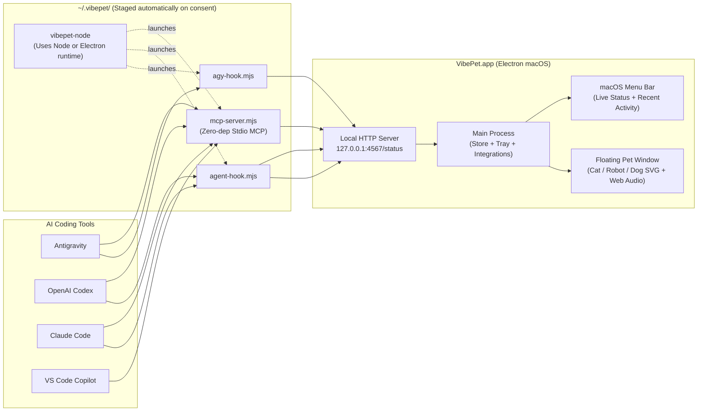

# VibePet

**A free, open-source macOS floating companion that shows what your AI coding agent is thinking, running, using which model, or waiting for you to approve — across Antigravity, VS Code, OpenAI Codex, and Claude Code.**

No more tab-switching back to your IDE every 10 seconds to check if your AI agent finished running tests or paused on an approval prompt. Just download the `.dmg`, open **VibePet**, pick your buddy (**Cat**, **Robot**, or **Dog**), and grant one-click permission to auto-connect your installed AI tools.

---

## Why VibePet?

When running autonomous AI coding agents, you often switch to a browser, docs, or Slack while the agent reads files, runs tests, or builds your app. Without ambient visibility, you only notice 5 minutes later that the agent has been sitting on an **Approve** prompt the entire time.

**VibePet** solves this locally and privately:
- **Zero-Config `.dmg` Install** — Download `VibePet.dmg` from GitHub Releases, drag to `/Applications`, and launch. No `git clone`, no `npm install`, no manual JSON editing.
- **Consent-First Auto-Connect** — Automatically detects installed IDEs/agents on your Mac and asks your explicit permission before safely adding only its own hook/MCP entries (and lets you disconnect anytime in 1 click).
- **3 Switchable Companions** — Choose between **Cat**, **Robot**, and **Dog** anytime from the Menu Bar or hover settings; both the floating SVG pet and the macOS Menu Bar icon update live.
- **Live Thoughts, Active Model & Approval Alerts** — Displays the active IDE badge, project name, **active AI model** (`⚡ gpt-5.5`, `⚡ claude-sonnet-4`, `⚡ gemini-3-pro`), headline status, a `💭` thought/command detail box, and a 6-step **Recent Activity** log in the macOS Menu Bar.
- **Always-on-Top & Click-Through** — Floats above every window (including native macOS fullscreen Spaces). Clicks on transparent regions pass right through to apps underneath, while hovering reveals quick controls and dragging moves your pet anywhere.
- **100% Free, Local, and Offline** — Runs strictly on `127.0.0.1:4567`, synthesizes notification sounds via Web Audio API (no external MP3 files), and never sends telemetry.

---

## Supported IDEs & AI Coding Agents

| Tool / IDE | Live Status & Thoughts | Approval Alerts (`waiting` chime) | Auto-Connect via Setup Dialog |
| :--- | :---: | :---: | :---: |
| **Antigravity** (Standalone & VS Code Extension) | ✅ Automatic Hooks + MCP | ✅ Unsandboxed commands, outside-workspace edits, questions & plans | ✅ Yes (`~/.gemini/config/`) |
| **OpenAI Codex** (VS Code Extension & CLI) | ✅ Automatic Hooks + MCP | ✅ `PermissionRequest` & `Notification` hooks | ✅ Yes (`~/.codex/`) |
| **Claude Code** (CLI & VS Code Extension) | ✅ Automatic Hooks + MCP | ✅ `PermissionRequest` & `Notification` hooks | ✅ Yes (`~/.claude/`) |
| **VS Code (GitHub Copilot Chat)** | ✅ Global MCP + Instructions | ✅ Via `update_pet_status` tool | ✅ Yes (`User/mcp.json`) |
| **Any other MCP / HTTP Client** | ✅ Standard Stdio MCP or `POST /status` | ✅ Supported | Manual JSON snippet |

---

## Quick Start (For End Users — No Code Required)

1. Download the latest **`VibePet-*.dmg`** from [**GitHub Releases**](../../releases).
2. Open the `.dmg` and drag **VibePet.app** into your **Applications** folder.
3. Launch **VibePet** from Spotlight or Applications.
   > *First-time macOS note:* Because this free open-source release is unsigned, if macOS says the app is from an unidentified developer, right-click `VibePet.app` → **Open** (or allow it in *System Settings → Privacy & Security*).
4. In the **Setup & Integrations** dialog:
   - Pick your favorite companion (**Cat**, **Robot**, or **Dog**).
   - Review the detected AI tools and click **Allow & Connect Selected**.
5. Reload your IDE window (or open a new chat) — your pet will come alive automatically!

---

## Visual States & Sound Alerts

| State | Color | Animation | Synthesized Web Audio Sound |
| :--- | :--- | :--- | :--- |
| `idle` | Sky Blue | Gentle float, blinking eyes, wagging tail / bobbing antenna | Silent |
| `thinking` | Lavender Purple | Tilted head, thinking pose, floating `?` bubble | Soft subtle blip |
| `coding` | Mint Green | Typing fast on a glowing mini laptop with scrolling code | Soft subtle blip |
| `waiting` | Amber / Orange | Excited bounce & waving paw, **pinned speech bubble** until resolved | 2-note *ding-dong* chime |
| `success` | Bright Green | Celebration cheer with twinkling stars (returns to `idle` after 10s) | 3-note `C-E-G` arpeggio |

---

## Architecture



### Repository Layout

```text
VibePet/
├── .github/workflows/release.yml   # Automated TypeScript check + macOS .dmg GitHub Release
├── app/                            # Strict TypeScript Electron macOS App
│   ├── src/
│   │   ├── shared/types.ts         # Shared domain types (PetStatus, CharacterType, Preferences)
│   │   ├── main/
│   │   │   ├── index.ts            # App lifecycle, single-instance lock, IPC coordination
│   │   │   ├── store.ts            # Persistent preferences (character, mute, window position)
│   │   │   ├── httpServer.ts       # Localhost HTTP server (127.0.0.1:4567)
│   │   │   ├── tray.ts             # Dynamic Cat/Robot/Dog Menu Bar icon, live status & history
│   │   │   ├── petWindow.ts        # Transparent always-on-top click-through BrowserWindow
│   │   │   ├── setupWindow.ts      # Consent & Character Picker modal window
│   │   │   └── integrations.ts     # Auto-detect & non-destructive installer/uninstaller
│   │   ├── preload/                # Context-isolated typed IPC bridges
│   │   └── renderer/
│   │       ├── pet/                # Floating pet stage, Cat/Robot/Dog SVGs & Web Audio synth
│   │       └── setup/              # Permissions & companion selection UI
│   ├── scripts/generate-icon.mjs   # Procedural 512x512 macOS icon generator
│   ├── tsconfig.json               # Main & preload TypeScript config
│   ├── tsconfig.renderer.json      # Renderer DOM TypeScript config
│   └── package.json                # electron-builder config (bundles compiled integrations)
├── integrations/                   # Zero-dependency TypeScript runtime bundled inside AI Pet.app
│   ├── src/
│   │   ├── mcp-server.mts          # Standalone Stdio JSON-RPC 2.0 MCP server
│   │   ├── agy-hook.mts            # Antigravity lifecycle hook
│   │   └── agent-hook.mts          # Codex & Claude Code lifecycle hook
│   └── tsconfig.json               # Compiles to zero-dep ESM (.mjs) in integrations/dist/
├── mcp-server/                     # Optional @modelcontextprotocol/sdk TypeScript MCP package
├── skills/pet-companion/SKILL.md   # Portable Agent Skill definition
└── LICENSE                         # MIT License
```

---

## Development & Building from Source

```bash
# 1. Install Electron app dependencies
cd app
npm install

# 2. Run in development mode
npm start

# 3. Build macOS AI Pet.app and .dmg (outputs to app/dist/)
npm run build:mac
```

### Publishing a GitHub Release with `.dmg`

This repository includes [release.yml](.github/workflows/release.yml). Whenever you push a version tag, GitHub Actions automatically builds `AI Pet-*.dmg` on a macOS runner and attaches it to the GitHub Release:

```bash
git tag v2.0.0
git push origin v2.0.0
```

---

## Local HTTP API

You can also integrate any custom script, CI watcher, or IDE plugin directly by sending a `POST` request to `http://127.0.0.1:4567/status`:

```bash
curl -X POST http://127.0.0.1:4567/status \
  -H "Content-Type: application/json" \
  -d '{
    "state": "waiting",
    "message": "Approval needed in IDE!",
    "detail": "Command: npm run deploy",
    "project": "my-app",
    "model": "claude-sonnet-4",
    "source": "claude-code"
  }'
```

---

## License

MIT — Free forever to use, modify, and share. See [LICENSE](./LICENSE).
